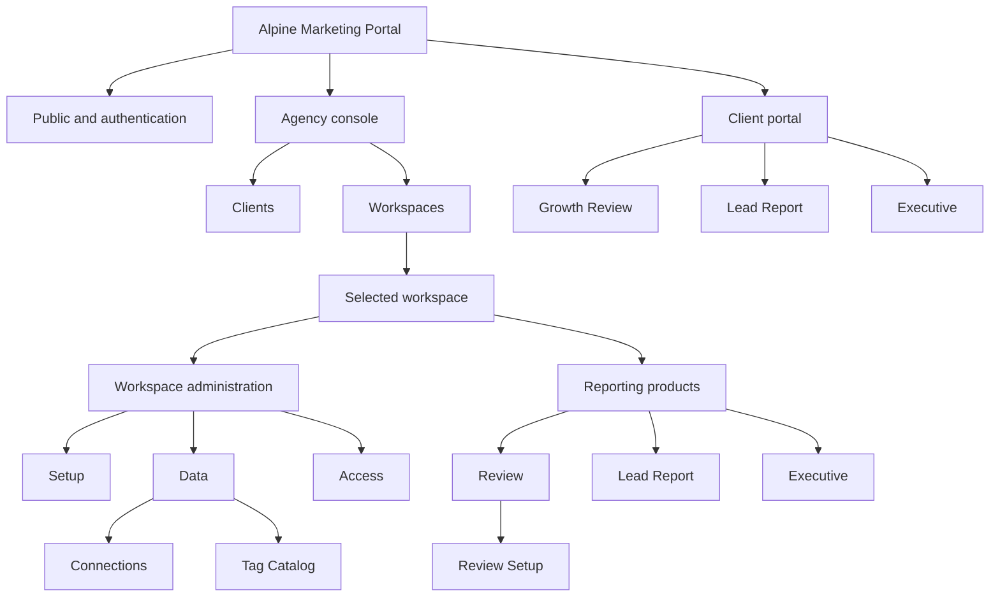
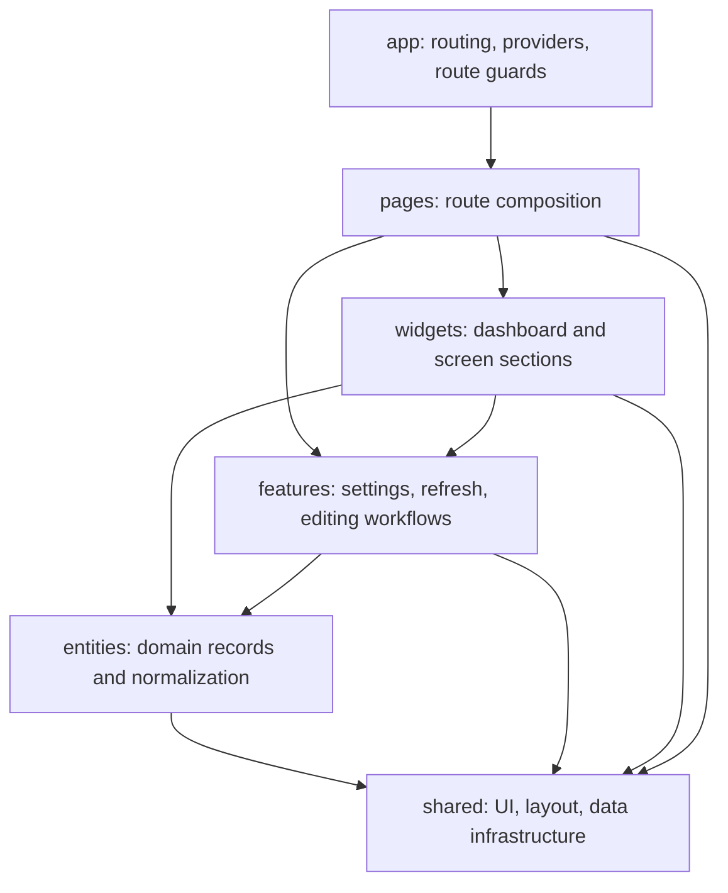
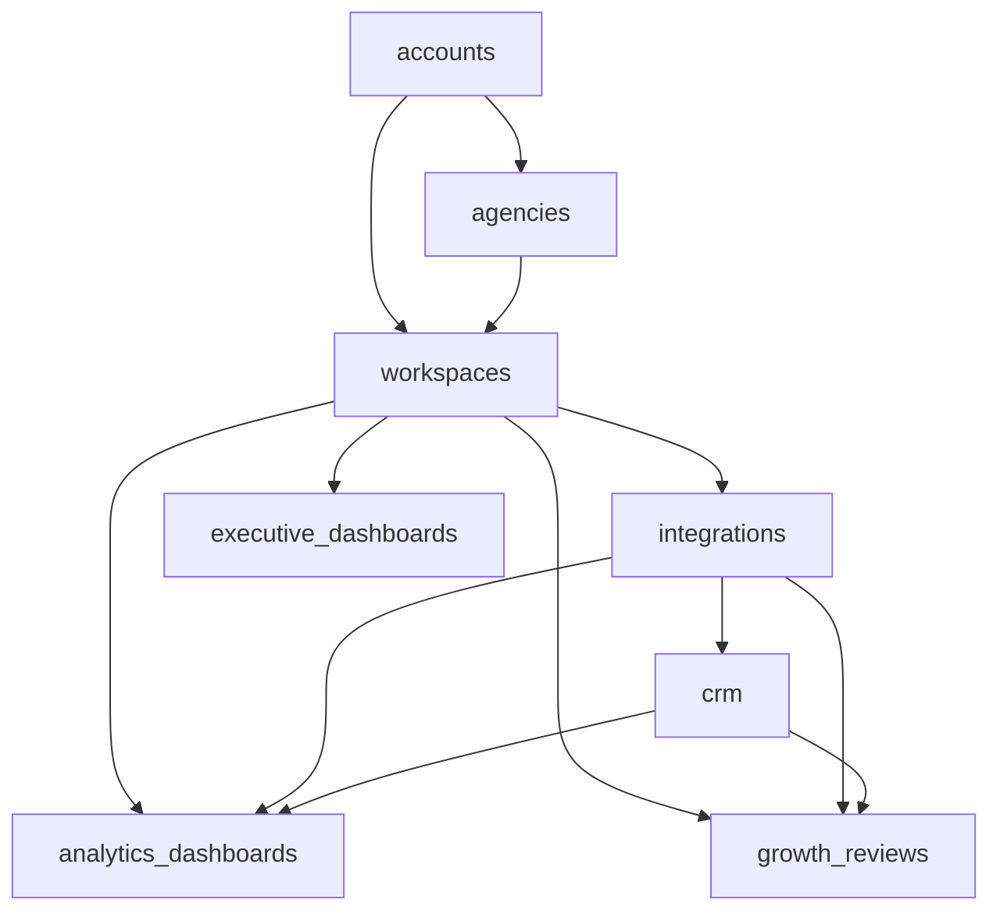

# Product Sitemap

```text
Status: Current implemented state
Last verified: 2026-11-04
Scope: Agency frontend, client portal frontend, and reporting backend ownership
```

This document maps the product structure that is implemented today. It is a
current-state reference, not the proposed long-term information architecture.

Primary code sources:

- `src/domain/navigation/routePaths.js`
- `src/app/routing/routeDefinitions.jsx`
- `src/app/routing/routeAccessMetadata.js`
- `src/features/admin-client-workspace/model/clientWorkspaceNavigation.js`
- Backend app URL modules in `client_portal`

## 1. Product Containers



## 2. Implemented Route Map

### Public And Authentication

```text
/
├── /login
├── /forgot-password
├── /reset-password
├── /accept-invite
├── /connect/assistant
└── /access-denied
```

### Agency Console

```text
/agency
├── /clients
│   └── /:clientId
├── /client-access
└── /workspaces
    └── /:workspaceId
        ├── /setup
        ├── /data
        ├── /tag-catalog
        ├── /review-setup
        ├── /access
        ├── /review
        ├── /lead-report
        └── /executive

/account/settings
```

The selected workspace renders the stable workspace destinations in one
horizontal navigation row:

```text
Setup | Data | Access | Review | Lead Report | Executive
```

The UI inserts a visual separator before the three reporting destinations.
`Tag Catalog` remains an addressable route owned by `Data` and appears in Data's
local navigation. `Review Setup` remains an addressable route owned by `Review`
and opens from the Review settings menu. The owning parent tab stays selected
on both child routes.

### Client Portal

```text
/portal
├── /growth-review
├── /lead-report
├── /executive
├── /settings
└── /workspaces/:workspaceId
    ├── /review
    ├── /lead-report
    └── /executive
```

The non-workspace dashboard routes are retained for the active/default
workspace. Workspace-specific routes are used when an account can address a
particular workspace directly.

### Legacy Redirects

```text
/admin/clients        -> /agency/clients
/admin/workspaces     -> /agency/workspaces
/admin/client-access  -> /agency/client-access
/client/growth-review -> /portal/growth-review
/client/settings      -> /portal/settings
```

## 3. Workspace Page Ownership

| Destination | Primary responsibility | Audience |
| --- | --- | --- |
| Setup | Workspace identity and base configuration | Agency |
| Data | Source connections and synchronized source data | Agency integrations admins |
| Data / Tag Catalog | Workspace-owned semantic tag catalog | Agency integrations admins |
| Review / Review Setup | Growth Review campaign definitions, mappings, tracks, and signals | Agency integrations admins |
| Access | Workspace memberships and invitations | Agency access admins |
| Review | Growth Review dashboard consumption and display customization | Agency and authorized client users |
| Lead Report | Weekly Lead Report consumption plus data, lifecycle, and display settings | Agency and authorized client users |
| Executive | Executive dashboard consumption | Agency and authorized client users |

## 4. Dashboard Action Ownership

### Growth Review

```text
Review page
├── campaign selection
├── reporting context
├── refresh
├── settings
│   ├── display customization
│   └── campaign configuration link
└── dashboard content

Review Setup page
├── campaign creation and archive
├── source connection and pipeline
├── campaign and touch keys
├── outcome mappings
├── tracks
└── track signals
```

### Lead Report

```text
Lead Report page
├── reporting period
├── refresh
├── settings
│   ├── display customization
│   └── data and lifecycle configuration
└── dashboard content
```

Unlike Growth Review, all three Lead Report configuration areas currently open
from one full-screen settings dialog on the dashboard page.

## 5. Frontend Ownership Map



The allowed dependency direction is:

```text
app -> pages -> widgets -> features -> entities -> shared
```

## 6. Backend Ownership Map



| Backend app | Ownership |
| --- | --- |
| `accounts` | Authentication, user identity, login/reset flows, plugin authorization |
| `agencies` | Agency records, agency memberships, agency-workspace relationships |
| `workspaces` | Workspaces, clients, memberships, invitations, access and tag catalog |
| `integrations` | Source connections, credentials, GHL synchronization and source metadata |
| `crm` | Locally synchronized contacts, opportunities and CRM activity records |
| `analytics_dashboards` | Generic dashboard definitions, configuration, snapshots, refresh runs, explanations and drilldowns |
| `growth_reviews` | Specialized Growth Review campaigns, mappings, calculations, layouts and refresh workflow |
| `executive_dashboards` | Executive dashboard read model |

## 7. Current Architecture Boundaries

The application currently has two reporting architectures:

```text
Specialized reporting
└── growth_reviews

Generic reporting platform
└── analytics_dashboards
    └── weekly-lead-report
```

`executive_dashboards` is a separate read model and is not currently managed as
an `analytics_dashboards` definition.

This separation is intentional current-state evidence. It must not be removed
from this map until the code has actually migrated.

## 8. Known Structural Tensions

This map exposes the following current inconsistencies without prescribing a
solution:

1. Workspace administration and reporting products share one primary tab row,
   separated visually but not represented as separate route containers.
2. Growth Review setup is a child route, while Lead Report setup is embedded
   in the dashboard dialog.
3. Route path, access, rendered route, and workspace navigation metadata are
   maintained in separate files.
4. Growth Review and generic analytics expose similar refresh, explanation and
   presentation concepts through separate implementations.
5. Client-facing reporting is represented as several dashboard destinations,
   while the long-term research model groups reporting under a broader results
   or Reports & Dashboards area.

## 9. Related Direction Documents

The following documents describe future direction and must not be confused with
this implemented-state map:

- `docs/research/client-control-center-information-architecture.md`
- `docs/research/clinic-client-portal-information-architecture.md`
- `docs/research/client-analytics-dashboard-ui-recommendations.md`
- `docs/frontend-architecture.md`
- `docs/domain-ownership-model.md`
